# Cynbit Technologies — Smart Project Discovery & Architectural CRM System

> **Full Stack Developer Assessment Prototype**  
> An enterprise-grade, interactive lead qualification and project discovery system engineered for [Cynbit Technologies](https://www.cynbit.in/).

[](https://nodejs.org)
[](https://react.dev)
[](https://vitejs.dev)
[](https://tailwindcss.com)
[](https://opensource.org/licenses/ISC)
[](#automated-testing)

---

## 1. Executive Summary & Problem Statement

### The Problem on the Existing Website
When visiting the live Cynbit Technologies website ([https://www.cynbit.in/](https://www.cynbit.in/)):
1. **Unstructured Ingestion**: The hero call-to-action (*"Start discovery"*) redirects visitors to the `/contact` page. The contact page contains **no structured web form**, offering only static `mailto:opportunities@cynbit.in` and phone links.
2. **Ambiguous Requirements**: Prospective enterprise clients, founders, and CTOs often do not know how to break down their project scope, or which combination of services (AI agents, web apps, cloud, mobile) fits their business goal.
3. **No Upfront Scoping or Qualification**: Budget constraints and delivery velocity expectations are not established upfront, leading to lengthy manual back-and-forth email exchanges.
4. **Lack of Transparency**: Clients receive no tracking reference or confirmation after reaching out.
5. **No Administrative CRM**: The engineering and sales teams have no unified dashboard to review, search, filter, update pipeline stages, or analyze demand metrics.

### The Solution: Smart Project Discovery System
We designed and implemented a **5-Step Interactive Project Discovery Wizard**, an **Enquiry Tracking Portal**, and a **Protected Admin CRM & Analytics Dashboard**:
- **Step 1: Service Architecture Selection** — Multi-selectable cards with interactive badges (AI Automation, Web Development, Mobile Apps, Custom Software, Cloud, UI/UX).
- **Step 2: Project Scope & Objectives** — Project name, primary objective chips, description with character counter, target audience presets, and dynamic feature tag builder.
- **Step 3: Investment & Velocity Parameters** — Transparent Indian Rupee (`₹`) budget tiers and realistic timeline options.
- **Step 4: Contact & Organization Details** — Full name, business email, phone, and optional company with real-time validation and NDA privacy guarantee.
- **Step 5: Review & Submission** — Comprehensive review summary with section edit shortcuts, duplicate prevention, confetti celebration, unique Reference ID (`CYN-2026-XXXX`), and printable summary.
- **Client Transparency Portal (`/track`)** — Enter reference ID to inspect real-time progress across 4 pipeline stages.
- **Protected Admin CRM (`/admin/dashboard`)** — JWT authenticated portal with KPI counters, real-time search, multi-filter pills, inline status updates, detailed inspection drawer, audit logs, and one-click CSV export.

---

## 2. Visual Walkthrough & Screenshots

| 1. Cynbit Home Page & Discovery Hero | 2. Step 1: Service Selection |
| :---: | :---: |
| 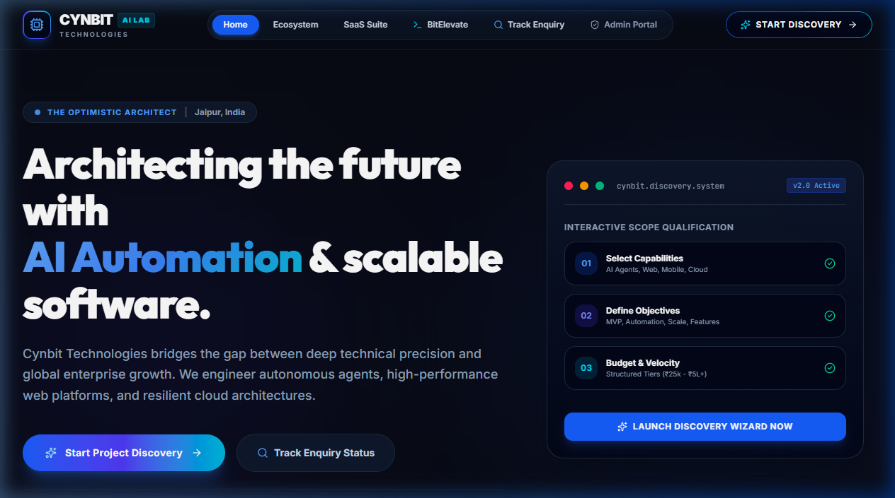 | 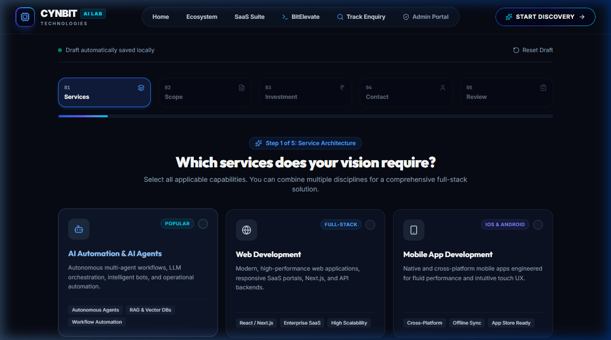 |

| 3. Step 2: Scope & Feature Tags | 4. Step 3: Budget & Timeline |
| :---: | :---: |
| 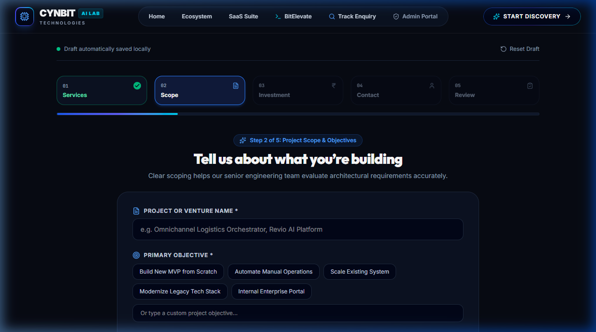 | 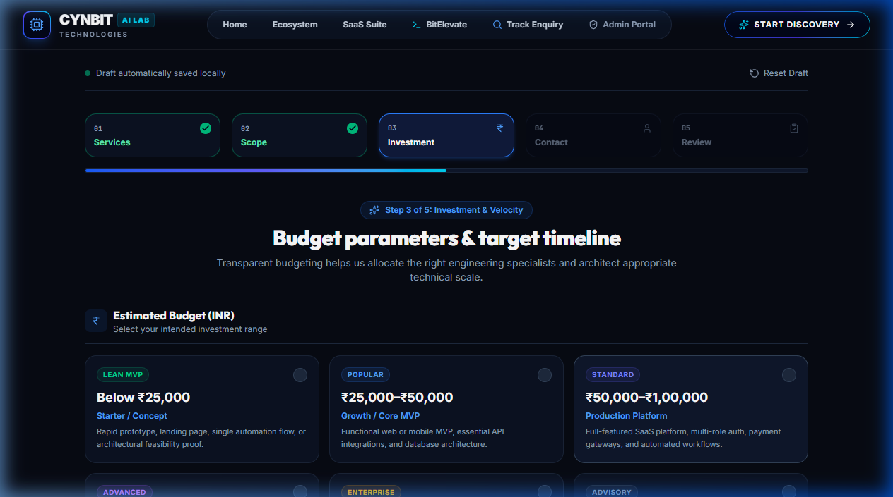 |

| 5. Step 4: Contact & Privacy Guarantee | 6. Step 5: Summary Review |
| :---: | :---: |
| 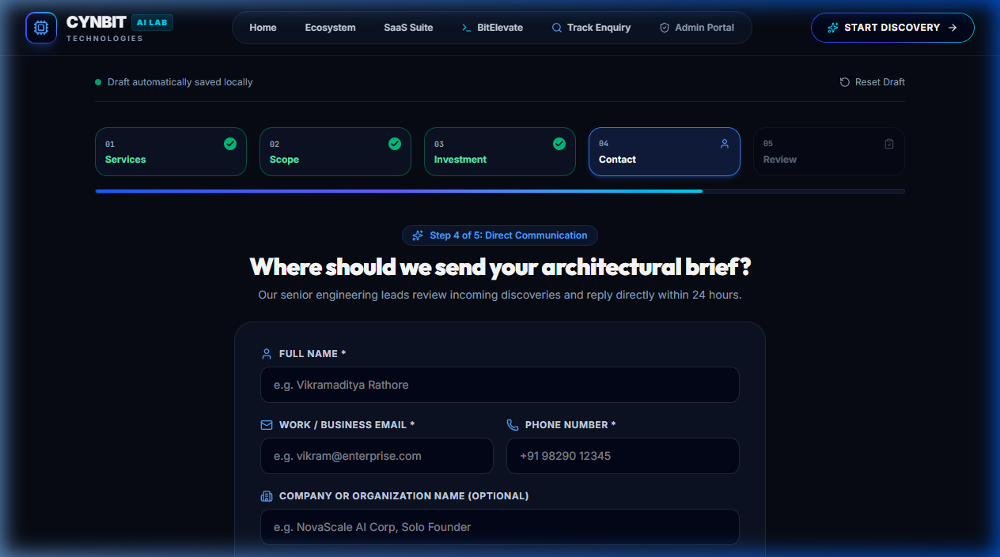 | 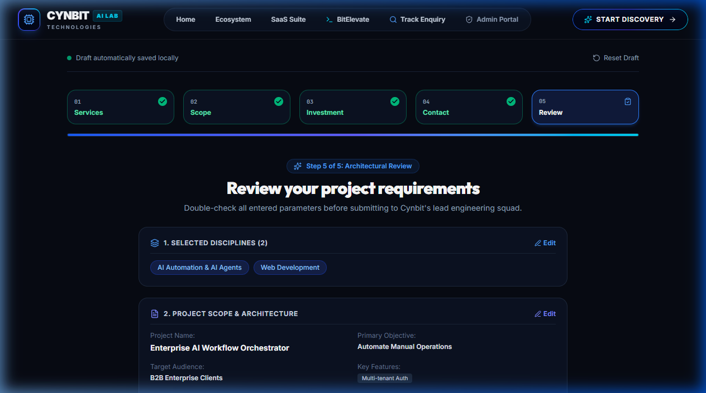 |

| 7. Success Screen with Reference ID | 8. Public Enquiry Tracker |
| :---: | :---: |
| 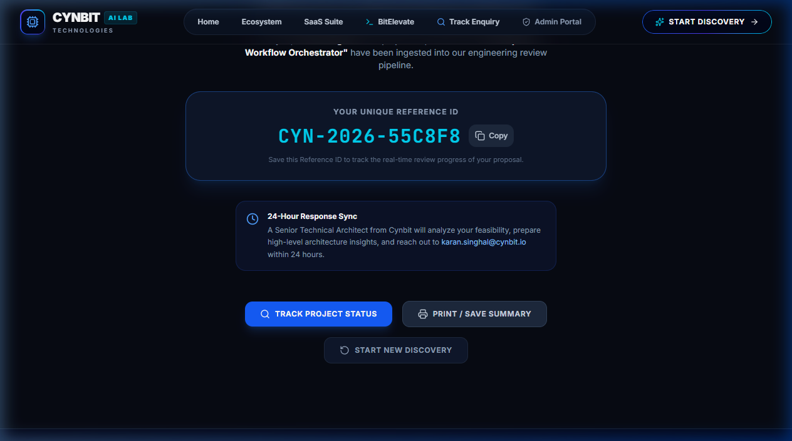 | 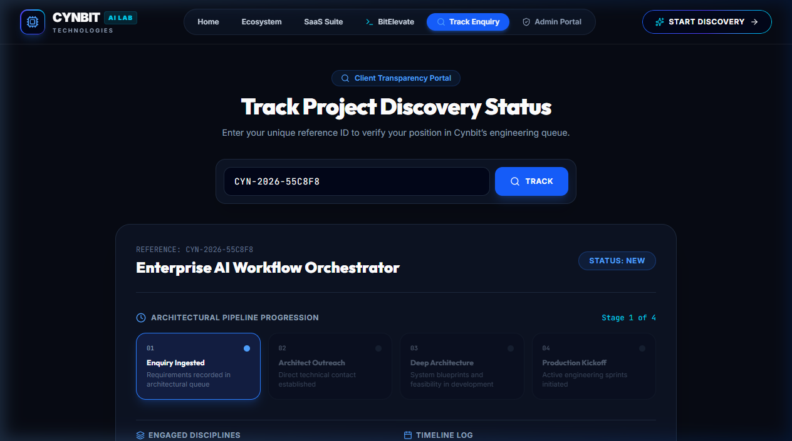 |

| 9. Admin Portal Login | 10. Admin Dashboard & Metrics |
| :---: | :---: |
| 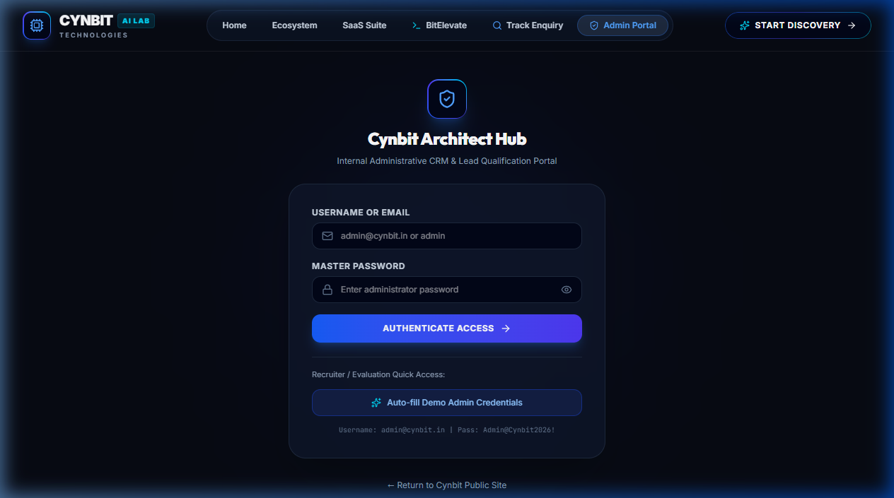 | 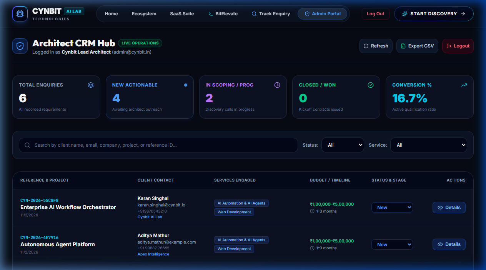 |

| 11. Full Details Modal | 12. Status Updated & Audit Log |
| :---: | :---: |
| 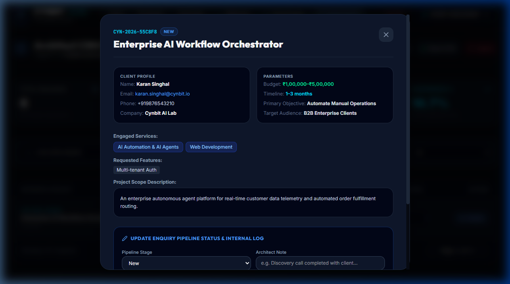 | 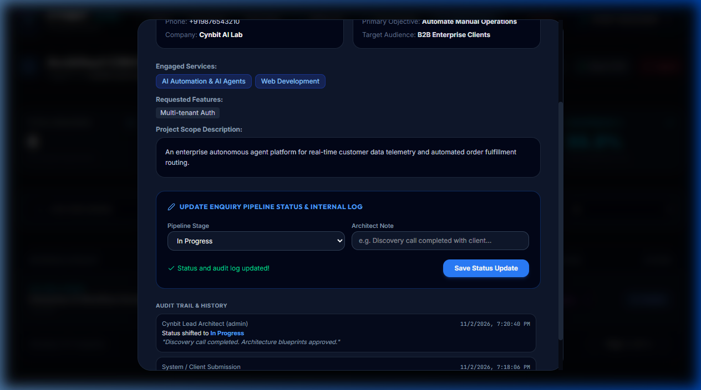 |

---

## 3. Technology Stack & Architectural Decisions

### Frontend
- **React 19 & Vite 6**: Lightning-fast hot module reloading, optimal bundle size (under 120 kB gzipped), and instant build times.
- **Tailwind CSS v4**: Utility-first styling with custom Cynbit branding tokens, glassmorphism (`glass-panel`, `glass-nav`), and dark aesthetic.
- **React Router v7**: Client-side single page app routing with protected routes and state management.
- **Lucide React**: Clean, modern iconography aligned with Cynbit's tech aesthetic.
- **Canvas Confetti**: Delightful micro-interaction feedback upon successful submission.

### Backend
- **Node.js (v22) & Express.js**: High-throughput REST API architecture.
- **Dual Database Persistence Layer (SQLite + PostgreSQL)**:
  - Zero-configuration **SQLite** out of the box via `sqlite3` driver (`server/data/cynbit_discovery.sqlite`), ensuring anyone cloning the repository can run `npm start` immediately without setting up external database daemons or credentials.
  - Production **PostgreSQL** support toggled seamlessly via `DATABASE_URL` in `.env`.
- **JWT & Bcrypt.js**: Secure token-based admin authentication with salted password hashes (10 rounds).
- **Express Rate Limit**: Anti-spam protection on discovery submissions (20/15min) and brute-force mitigation on admin login (15/15min).
- **Helmet & CORS**: Strict HTTP security headers and configurable CORS origin whitelisting.

---

## 4. Repository Structure

```
Cynbit_Fullstack_Solution/
├── client/                     # Frontend React Application
│   ├── src/
│   │   ├── components/         # Reusable UI components
│   │   │   ├── DiscoverySteps/ # Wizard Steps 1 to 5 + Success Screen
│   │   │   │   ├── StepServices.jsx
│   │   │   │   ├── StepProjectInfo.jsx
│   │   │   │   ├── StepBudgetTimeline.jsx
│   │   │   │   ├── StepContact.jsx
│   │   │   │   ├── StepReview.jsx
│   │   │   │   └── StepSuccess.jsx
│   │   │   ├── Navbar.jsx      # Glassmorphic header with navigation
│   │   │   └── Footer.jsx      # Cynbit enterprise footer
│   │   ├── context/
│   │   │   ├── AuthContext.jsx # Admin JWT session management
│   │   │   └── DiscoveryContext.jsx # Wizard multi-step & local draft persistence
│   │   ├── pages/              # Routed views
│   │   │   ├── Home.jsx        # Landing page with hero & CTAs
│   │   │   ├── DiscoveryWizardPage.jsx # 5-step wizard container
│   │   │   ├── TrackEnquiryPage.jsx    # Public reference tracker
│   │   │   ├── AdminLoginPage.jsx      # Admin login with quick demo fill
│   │   │   ├── AdminDashboardPage.jsx  # CRM dashboard & KPI charts
│   │   │   └── NotFoundPage.jsx
│   │   ├── services/
│   │   │   └── api.js          # Centralized fetch API client
│   │   ├── App.jsx             # Route definitions
│   │   ├── main.jsx            # React root entry
│   │   └── index.css           # Tailwind design tokens & typography
│   ├── package.json
│   ├── vite.config.js
│   ├── .env.example
│   └── .env
│
├── server/                     # Backend REST API Server
│   ├── src/
│   │   ├── config/
│   │   │   └── db.js           # Agnostic SQLite & PostgreSQL query adapter
│   │   ├── controllers/
│   │   │   ├── authController.js   # Admin login & session verification
│   │   │   ├── enquiryController.js# Discovery submissions, tracking, CRUD
│   │   │   └── statsController.js  # Pipeline metrics & service demand breakdown
│   │   ├── middleware/
│   │   │   ├── auth.js         # JWT verification middleware
│   │   │   ├── errorHandler.js # Centralized error & 404 handler
│   │   │   ├── rateLimiter.js  # Spam prevention & brute force defense
│   │   │   └── validation.js   # Input validation & sanitization
│   │   ├── routes/
│   │   │   ├── adminRoutes.js  # Protected CRM & analytics endpoints
│   │   │   ├── authRoutes.js   # Authentication endpoints
│   │   │   └── enquiryRoutes.js# Public submission & tracking routes
│   │   ├── utils/
│   │   │   ├── referenceGenerator.js # CYN-2026-XXXX generator
│   │   │   └── seed.js         # Admin user & demo enquiry seeder
│   │   └── server.js           # Express main server entry point
│   ├── tests/
│   │   └── api.test.js         # Automated integration tests
│   ├── package.json
│   ├── .env.example
│   └── .env
│
├── screenshots/                # High-resolution screenshots of features
├── dev-runner.js               # Concurrently launches client & server in dev
├── package.json                # Root package with unified workspace commands
├── TECHNICAL_REPORT.md         # Full architectural & audit report
└── README.md
```

---

## 5. Quick Start & Installation Guide

### Prerequisites
- **Node.js**: v18.0.0 or higher (v22 recommended)
- **npm**: v9.0.0 or higher
- Git

### Installation Steps

1. **Clone the repository:**
   ```bash
   git clone https://github.com/your-username/Cynbit_Fullstack_Solution.git
   cd Cynbit_Fullstack_Solution
   ```

2. **Install all dependencies:**
   ```bash
   npm run install:all
   ```
   *(Or individually inside `client` and `server` folders via `npm install`).*

3. **Configure Environment Variables:**
   Both `client` and `server` include ready `.env` files pre-configured for local execution.
   If needed, copy the example files:
   ```bash
   cp server/.env.example server/.env
   cp client/.env.example client/.env
   ```

4. **Launch Development Environment:**
   Run the root dev runner:
   ```bash
   npm run dev
   ```
   - **Frontend App**: [http://localhost:5173](http://localhost:5173)
   - **Backend API**: [http://localhost:5000](http://localhost:5000)
   - **Health Check**: [http://localhost:5000/api/health](http://localhost:5000/api/health)

5. **Single-Command Production Run:**
   ```bash
   npm run build
   npm start
   ```
   The backend Express server will automatically serve both the REST API and the compiled React SPA at [http://localhost:5000](http://localhost:5000).

---

## 6. Admin Credentials for Evaluators

For easy evaluation by the recruitment team, default administrator credentials are automatically seeded on server launch:

| Field | Value |
| :--- | :--- |
| **Admin Portal URL** | [http://localhost:5173/admin/login](http://localhost:5173/admin/login) |
| **Identifier (Email)** | `admin@cynbit.in` |
| **Password** | `Admin@Cynbit2026!` |
| **Quick Action** | Click the **"Auto-fill Demo Admin Credentials"** button on the login screen |

---

## 7. REST API Documentation

### Public Endpoints

#### 1. Submit Project Discovery
- **`POST /api/enquiries`**
- **Rate Limit**: 20 requests per 15 minutes per IP
- **Request Body**:
  ```json
  {
    "services": ["AI Automation & AI Agents", "Web Development"],
    "projectName": "Autonomous Customer Concierge",
    "projectDesc": "Building an autonomous customer triage system with custom RAG.",
    "objective": "Automate Manual Operations",
    "targetAudience": "B2B Enterprise Clients",
    "features": ["Autonomous Agents", "SSO Auth", "Vector DB"],
    "budget": "₹1,00,000–₹5,00,000",
    "timeline": "1–3 months",
    "fullName": "Karan Singhal",
    "email": "karan.singhal@enterpriseflow.io",
    "phone": "+91 98290 99881",
    "company": "FlowSystems India"
  }
  ```
- **Response `201 Created`**:
  ```json
  {
    "success": true,
    "message": "Project discovery submitted successfully. Our lead architects will analyze your requirements.",
    "referenceId": "CYN-2026-55C8F8",
    "enquiryId": 4,
    "createdAt": "2026-11-02T13:42:00.000Z"
  }
  ```

#### 2. Track Project Enquiry
- **`GET /api/enquiries/track/:refId`**
- **Example**: `GET /api/enquiries/track/CYN-2026-55C8F8`
- **Response `200 OK`**:
  ```json
  {
    "success": true,
    "enquiry": {
      "referenceId": "CYN-2026-55C8F8",
      "projectName": "Autonomous Customer Concierge",
      "services": ["AI Automation & AI Agents", "Web Development"],
      "status": "In Progress",
      "submittedAt": "2026-11-02T13:42:00.000Z",
      "lastUpdated": "2026-11-02T13:48:00.000Z"
    }
  }
  ```

---

### Admin Protected Endpoints (`Authorization: Bearer <JWT>`)

| Method | Endpoint | Description |
| :--- | :--- | :--- |
| `POST` | `/api/auth/login` | Authenticate admin user, returns JWT token |
| `GET` | `/api/auth/me` | Fetch active admin session profile |
| `GET` | `/api/admin/stats` | Pipeline KPI metrics, conversion %, and service distribution |
| `GET` | `/api/admin/enquiries` | Paginated enquiry records with `search`, `status`, `service` filters |
| `GET` | `/api/admin/enquiries/:id` | Full enquiry details + status audit log history |
| `PATCH` | `/api/admin/enquiries/:id/status` | Update pipeline stage (`New`, `Contacted`, `In Progress`, `Completed`, `Rejected`) + note |
| `DELETE` | `/api/admin/enquiries/:id` | Remove enquiry record |

---

## 8. Automated Testing

The project includes an automated test suite executed with Node's native test runner (`node:test`) and Supertest:

```bash
npm run test
```

### Test Results (11 Passed, 0 Failed)
```
✔ GET /api/health should return 200 OK and healthy status
✔ POST /api/enquiries should reject empty or invalid payload with 400
✔ POST /api/enquiries should successfully submit valid project discovery
✔ POST /api/enquiries should detect duplicate submissions
✔ GET /api/enquiries/track/:refId should return enquiry status for valid reference ID
✔ GET /api/enquiries/track/:refId should return 404 for non-existent reference ID
✔ POST /api/auth/login should reject invalid credentials with 401
✔ POST /api/auth/login should authenticate seeded admin and return JWT
✔ GET /api/admin/enquiries should reject request without JWT with 401
✔ GET /api/admin/enquiries should return enquiries list with valid JWT
✔ GET /api/admin/stats should return aggregated KPI analytics

11 tests passed in ~950ms.
```

---

## 9. Production Deployment Guidelines

### Option A: Render / Railway / Heroku (Unified Service)
1. Set Environment Variables:
   - `NODE_ENV=production`
   - `JWT_SECRET=your_production_secret_key`
   - `PORT=5000` (or injected by platform)
   - *(Optional)* `DATABASE_URL=postgres://...`
2. Build Command:
   ```bash
   npm run build
   ```
3. Start Command:
   ```bash
   npm start
   ```

### Option B: Docker Container
```dockerfile
FROM node:22-alpine
WORKDIR /app
COPY package*.json ./
COPY client/package*.json client/
COPY server/package*.json server/
RUN npm run install:all
COPY . .
RUN npm run build
EXPOSE 5000
CMD ["npm", "start"]
```

---

## 10. Acknowledgements & Author

Crafted with engineering rigor for the **Cynbit Technologies Full Stack Developer Assessment**.  
© 2026 Cynbit Technologies. Engineered for Optimism.
